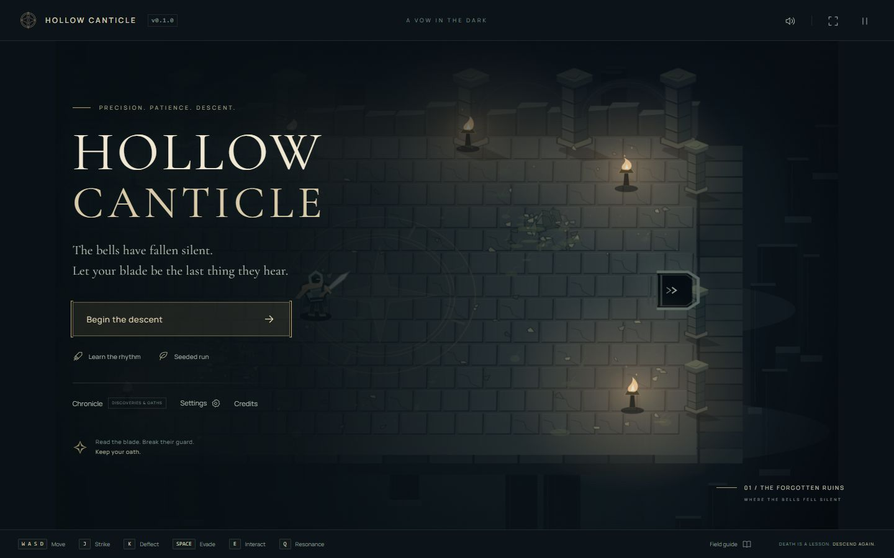

# Hollow Canticle

**A vow in the dark. A blade against the silence.**

An original desktop browser dungeon crawler built around readable weapon rhythms,
precise deflections, posture breaks, and short cinematic duels. Version **0.1.0**.
No backend, accounts, external assets service, or telemetry.



## Play locally

Use **Node 24 LTS** (recommended; Vite requires at least 22.12 on the Node 22 line).

```sh
npm install
npm run dev
```

Open the localhost URL printed by Vite. Choose **Learn the rhythm** for safe training,
or **Begin the descent** to choose a starting weapon and seed. New weapons unlock
in the Chronicle using embers retained at the end of a run. Seeded runs reproduce
floor layouts and encounters, while your combat choices remain live.

```sh
npm run lint
npm run test
npm run build
npm run preview
```

Production files are written to `dist/`. Fonts are bundled locally. Node 22.12 can
build and test the project, but the linter's visitor-key dependency recommends
22.13 or newer; Node 24 avoids that engine warning.

## The descent

- **Defend, then answer.** Tap deflect as a strike lands. A perfect deflection has
  a smaller window and stronger guard pressure, sparks, hit stop, and sound.
  Strike during the opening for a counter. Enemy guard recovers if you withdraw.
- **Read the whole weapon.** Sweeps, grabs, and heavy smashes require an evade.
  A greatblade can perfectly turn a smash. Feints punish early defenses.
- **Deliver the final toll.** When guard breaks, close the distance and press E.
  Different weapons and opponents select different finisher effects.
- **Find your cadence.** Clean play generates Focus. At high Focus, staying close
  creates counter opportunities. At 100, Q releases a posture shockwave.
- **Choose your route.** Floors contain a mandatory spine and optional loops with
  shrines, treasure, hazards, healing, and a discoverable secret. Every third
  floor holds a two-phase guardian. The stairway continues the run indefinitely.


## Controls

| Input           | Action                                               |
| --------------- | ---------------------------------------------------- |
| WASD / arrows   | Move                                                 |
| Mouse           | Aim / soft target                                    |
| J / left mouse  | Strike; counter during an opening                    |
| K / right mouse | Deflect                                              |
| Space           | Evade / dodge                                        |
| E               | Interact, enter a passage, or execute a broken enemy |
| Q               | Resonance at 100 Focus                               |
| Esc             | Pause / resume                                       |
| 1 / 2 / 3       | Choose a relic                                       |

Keyboard and mouse are required. A small-screen notice explains this on phones.
Settings include audio levels, parry assistance, reduced motion, impact flashes,
camera shake, and atmospheric detail. The top bar offers fullscreen and mute.
Settings, discoveries, statistics, and weapon unlocks persist on this device.
An active run does **not** resume after a reload.

## Implemented content

| System            | v0.1.0 content                                                                                             |
| ----------------- | ---------------------------------------------------------------------------------------------------------- |
| Enemies           | Cinder Warden, Grave Aegis, Veilblade, Hollow Lancer, Moth Reaver, Drowned Cantor, Bellbreaker, Sporebound |
| Guardian          | The Unrung Saint, two phases with faster altered rhythms                                                   |
| Weapons           | Oathkeeper, Moth & Thorn, Pilgrim's Reach, Last Toll                                                       |
| Relics            | 18 event-driven relics across Faded, Rare, and Sacred tiers                                                |
| Biomes            | Forgotten Ruins, Drowned Shrine, Fungal Choir, Winter Cloister, Ember Foundry                              |
| Mutations         | After depth five, a second biome contributes materials and hazards                                         |
| Elite traits      | Patient, Relentless, Armored                                                                               |
| Chamber modifiers | Darkness, Resonant, Blood pact, Unstable, Silence                                                          |
| Rooms             | 12 per floor, 8 authored obstacle arrangements × 4 orientations                                            |

Relics include Echoing Steel's every-third-perfect shockwave, Ghost Step's enlarged
parry after a dodge, Mirror Fang's rear reposition, Ember Edge's burning posture,
Hungry Blade's finisher-fed attacks, and Lightning Thread's chained finisher damage.
The Chronicle reveals descriptions as relics are discovered.

## Generation and architecture

The generator assembles a connected pacing grammar rather than scattering enemies
in random rectangles. Biome affinities, encounter budgets, compatibility rules,
and recent-template downweighting influence content. Ordinary rooms have at most
two opponents, with one active attack token. Enemy health stays bounded at deep
floors; difficulty comes from patterns, combinations, modifiers, and mutations.

TypeScript simulation is separate from rendering and input. Phaser owns scene
lifecycle and display scaling; Canvas 2D draws cached masonry, depth-sorted
silhouettes, light pools, particles, and the HUD. HTML dialogs handle menus.
WebAudio synthesizes all sounds. Separate random streams isolate generation,
loot, and visual effects.

See [architecture](docs/ARCHITECTURE.md), [design](docs/GAME_DESIGN.md),
[QA record](docs/QA.md), and [next release priorities](ROADMAP.md).

## QA & development tools

`npm test` runs pure combat/save tests, world simulations, and a 10,000-floor stress
test checking reachability, door clearance, budget validity, biome affinity, rewards,
and fair group combinations. The stress test takes roughly 18 seconds on the
development machine. CI runs lint, tests, and production build.

Append `?debug` to the URL for collision and timing overlays, a complete minimap,
enemy spawning, weapon swaps, relic injection, depth jumps, modifier selection,
invincibility, healing, guard breaks, and slow-motion controls. These controls are
absent from the normal interface. No external analytics are collected.

## GitHub Pages

The repository includes automatic CI and Pages deployment workflows.

1. Push this repository to GitHub with the release on the `main` branch.
2. In **Settings → Pages → Build and deployment → Source**, choose **GitHub Actions**.
3. The **Deploy to GitHub Pages** workflow validates the game, builds it, and publishes
   the artifact. Its environment summary provides the live URL.

Vite uses `base: './'`, so bundled assets resolve under repository subpaths and on
custom domains. No GitHub remote is configured in the supplied workspace; no public
site or GitHub release has been created. Deployment workflow execution therefore
remains unverified until a repository is connected.

## Scope and next steps

This is an intentionally compact indie release with procedural vector-style art,
a constrained branching floor grammar, synthesized ambience, and one guardian.
Biomes add distinct materials and environmental rules, while sharing the room
construction system. Human combat balancing and broader device performance tests
remain valuable next steps. Controller support, touch, merchants, ranged enemies,
weapon exchanges during a run, and mid-run saves are outside this release.

Gameplay video: capture is planned after human balance playtesting; no trailer is
included. The screenshots here are captured from the actual local build.

## License & credits

Code and original generated art/audio are [MIT](LICENSE). Phaser is MIT; bundled
Cormorant Garamond and Manrope fonts are SIL OFL 1.1. See [credits](CREDITS.md) and
`public/licenses/`. The supplied concept is a design reference only and is not
distributed. Precision combat inspiration does not imply affiliation with any
commercial game.
