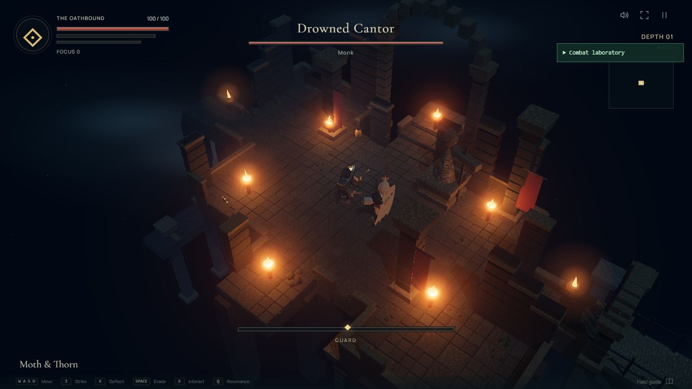
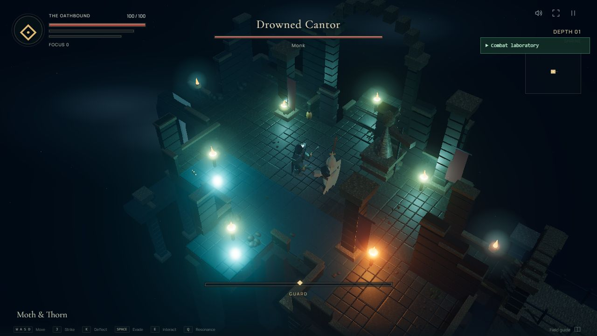
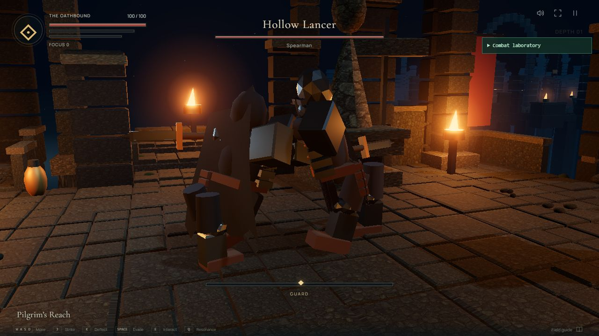
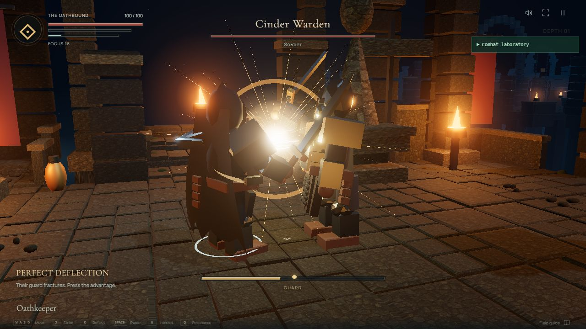
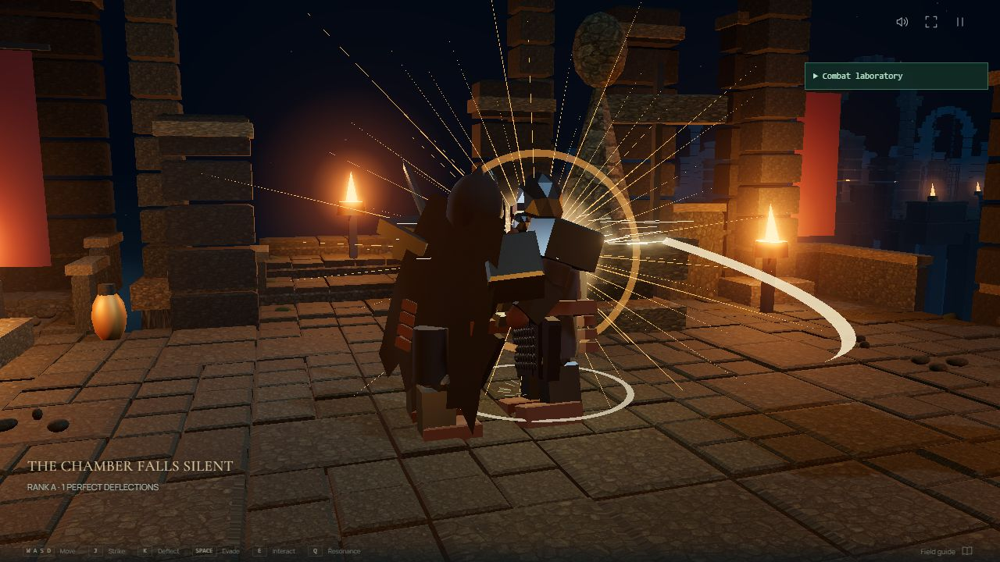
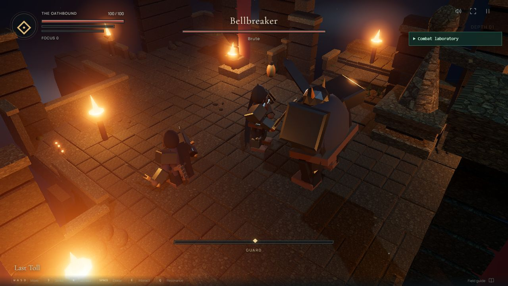
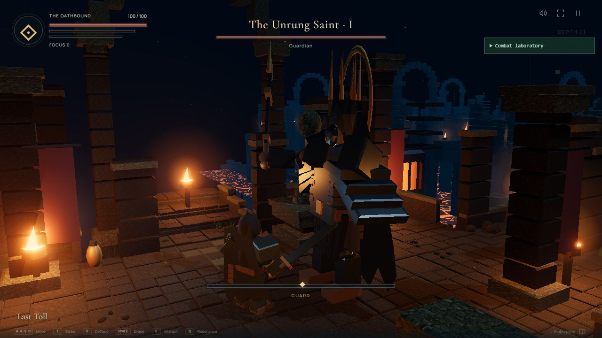
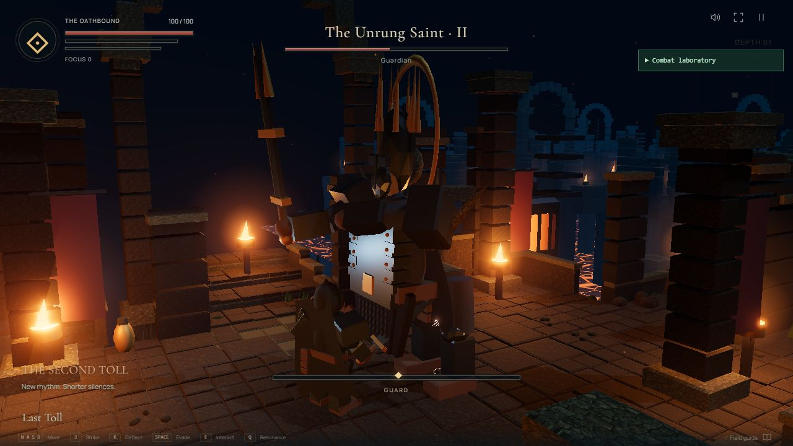

# v0.3 visual review

These are production WebGL captures from the combat laboratory. No concept image
is used as a gameplay backdrop. See [QA](QA-v0.3.md) for capture conditions and limits.

## Direction and remaining gap

The supplied target remains dark blue ruins, restrained warm fire, readable steel,
large fighters, and concentrated contact energy. The preserved world supplies depth
and atmosphere; the new silhouettes and closer lateral framing improve combat reading.
The constructed meshes still fall short of the target's organic detail and animation
craft. This is a review build, not a claim of matching the reference.

## Exploration foundation

## Weapon contact and execution

The spear preview uses a linear contact pose and bounded support-hand targeting.
The deflection is a real input-driven perfect parry; the execution impact is delayed
until the sampled finishing blow. The brighter flash deliberately distinguishes mastery.

## Group silhouettes

The Bellbreaker's disproportionately wide upper body and the Reaver's low stance
read differently at the intermediate combat camera distance.

## Saint transformation

The mantle disappears and crown growths become visible in phase two. Framing review
led to a larger vertical margin for the crown, raised weapon, and player feet.

