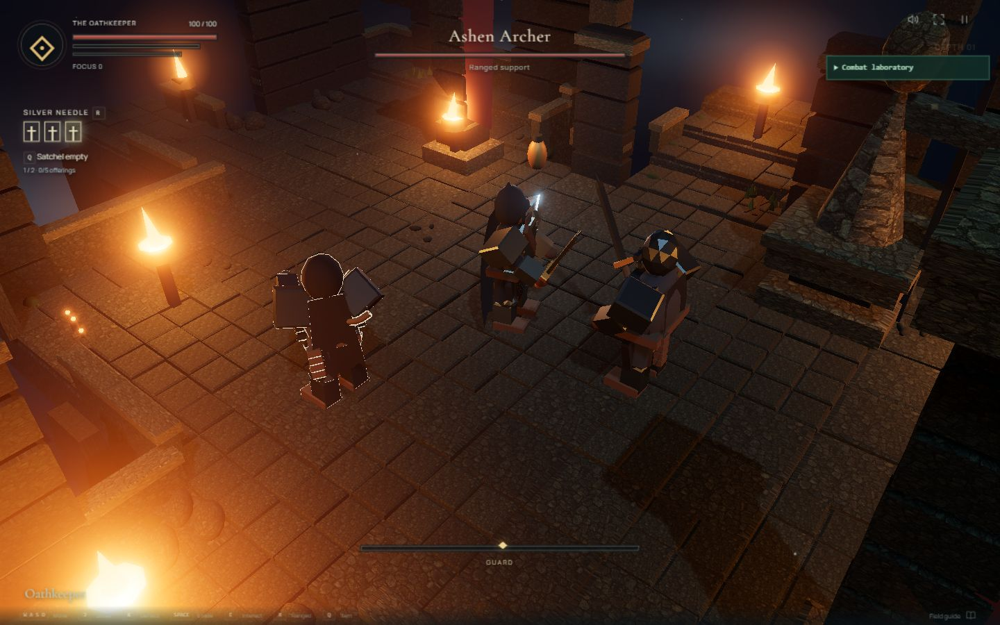
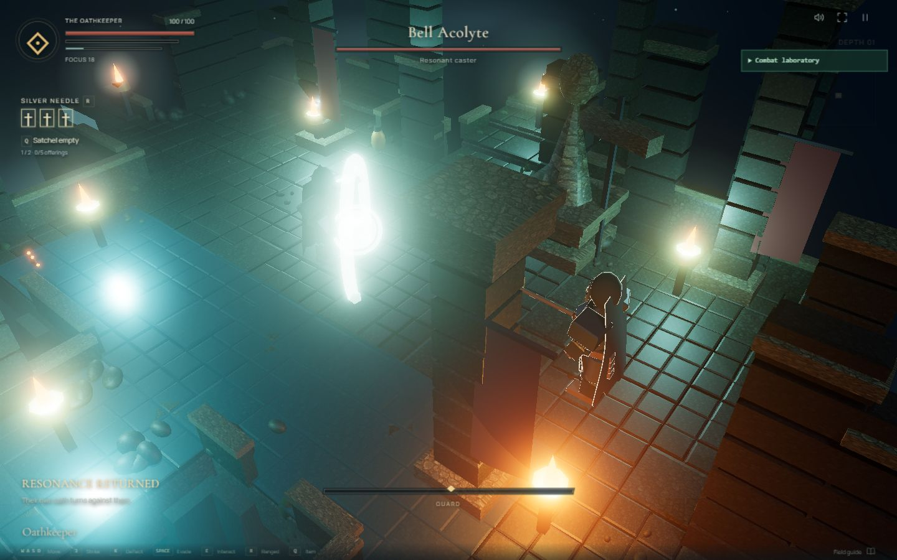
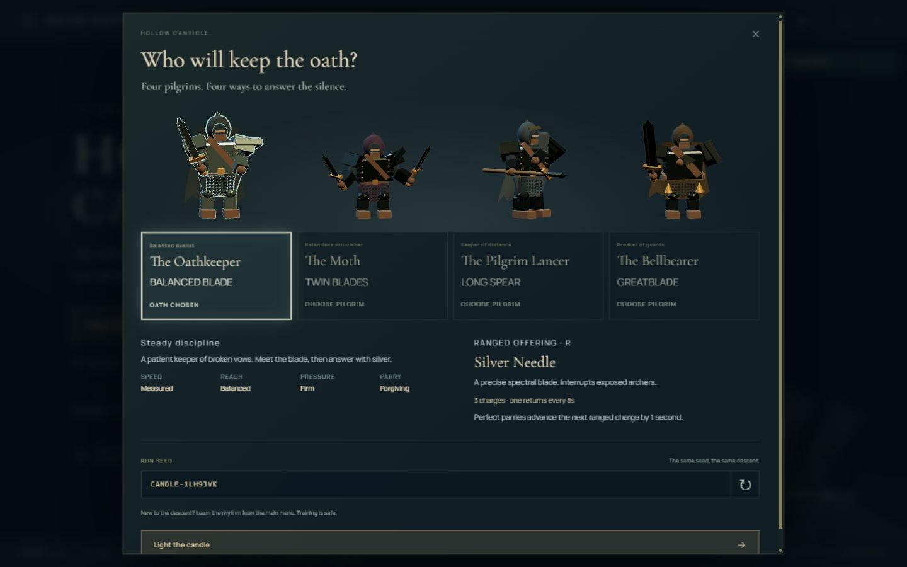

# v0.4 production visual review

Captured on 2026-10-23 from the built game in the desktop app browser. These are
actual game frames. Laboratory captures use supported encounter selection,
time pause and frame stepping; they are not evidence of ordinary-run victories.
See [QA](QA-v0.4.md) for input checks, scope and limitations.

| Capture                                                            | Evidence                                                                                     |
| ------------------------------------------------------------------ | -------------------------------------------------------------------------------------------- |
| [Character selection](screenshots/v04/character-selection.jpg)     | Four rendered Pilgrims; selected menu model and choice outlined.                             |
| [Lancer selection](screenshots/v04/lancer-selection.jpg)           | Long spear profile and corresponding discipline details. Locked preview remains inspectable. |
| [390px selection](screenshots/v04/selection-mobile.jpg)            | Two-column readable choices, scrollable details, no horizontal overflow.                     |
| [Oathkeeper duel](screenshots/v04/oathkeeper-duel.jpg)             | Balanced sword stance in close framing; opponent receives gameplay outline.                  |
| [Moth Knives](screenshots/v04/moth-knives.jpg)                     | Moth against Veilblade/Acolyte, knife release and charge HUD.                                |
| [Lancer Javelin](screenshots/v04/lancer-javelin.jpg)               | Committed thrown spear in Bellbreaker/Archer scenario.                                       |
| [Bellbearer Last Toll](screenshots/v04/bellbearer-last-toll.jpg)   | Travelling resonance against three enemies.                                                  |
| [Focused enemy](screenshots/v04/focused-enemy.jpg)                 | Archer selected in mixed combat; selected shell and target UI agree.                         |
| [Melee/ranged group](screenshots/v04/melee-ranged-group.jpg)       | Warden/Archer framing after melee defense/counter.                                           |
| [Arrow flight](screenshots/v04/arrow-flight.jpg)                   | Physical hostile arrow crossing the room.                                                    |
| [Arrow reflection](screenshots/v04/arrow-reflection.jpg)           | Contact-position metallic defense fan and returned shot.                                     |
| [Reflected arrow break](screenshots/v04/reflected-arrow-break.jpg) | Shooter broken by its returned arrow.                                                        |
| [Orb reflection](screenshots/v04/orb-reflection.jpg)               | Magic-specific compression rings at projectile contact.                                      |
| [Pickup and buff](screenshots/v04/consumable-pickup-buff.jpg)      | Physical vial, collection context and active Ash Cordial duration.                           |
| [Saint phase one](screenshots/v04/boss-phase-one.jpg)              | Foundry boss framing and focused boss outline.                                               |
| [Saint phase two](screenshots/v04/boss-phase-two.jpg)              | Second-phase model and announcement.                                                         |
| [Relic reward](screenshots/v04/relic-reward.jpg)                   | Actual one-choice result with matching keyboard hint.                                        |

The requested correction is visible in the combat captures: the opponent gets the
outline, while the player retains ordinary rim lighting. Hidden-cursor and relative
mouse selection were separately checked through actual inputs and computed cursor
state; a still image alone cannot prove either interaction.

The art remains procedural articulated geometry. Low-angle foreground occlusion,
support-hand detail, narrow rooms and sustained performance need further review.
