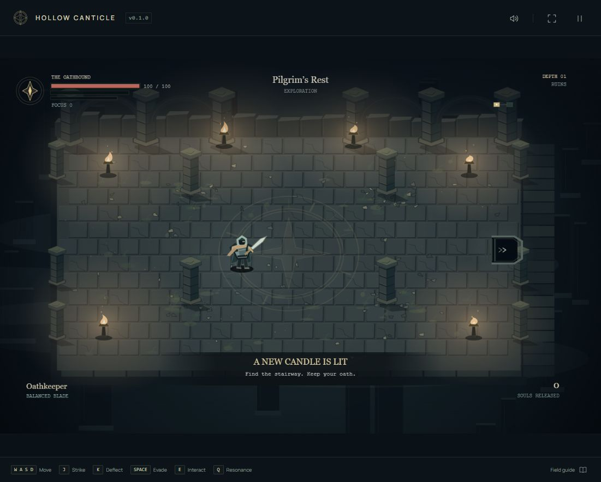
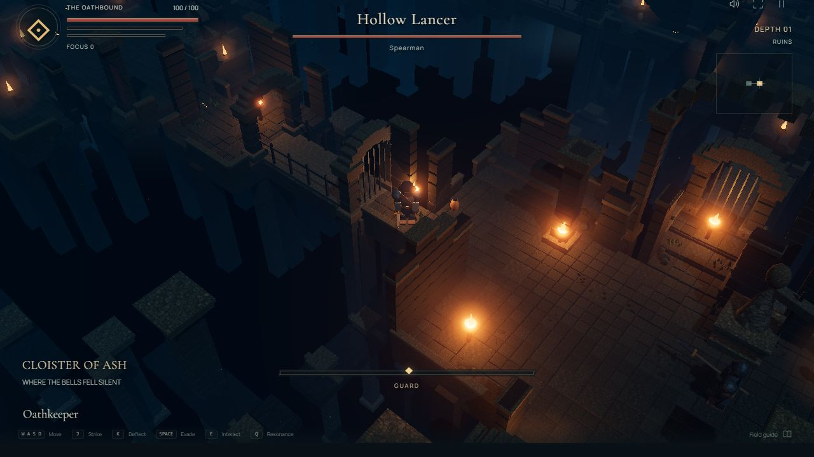
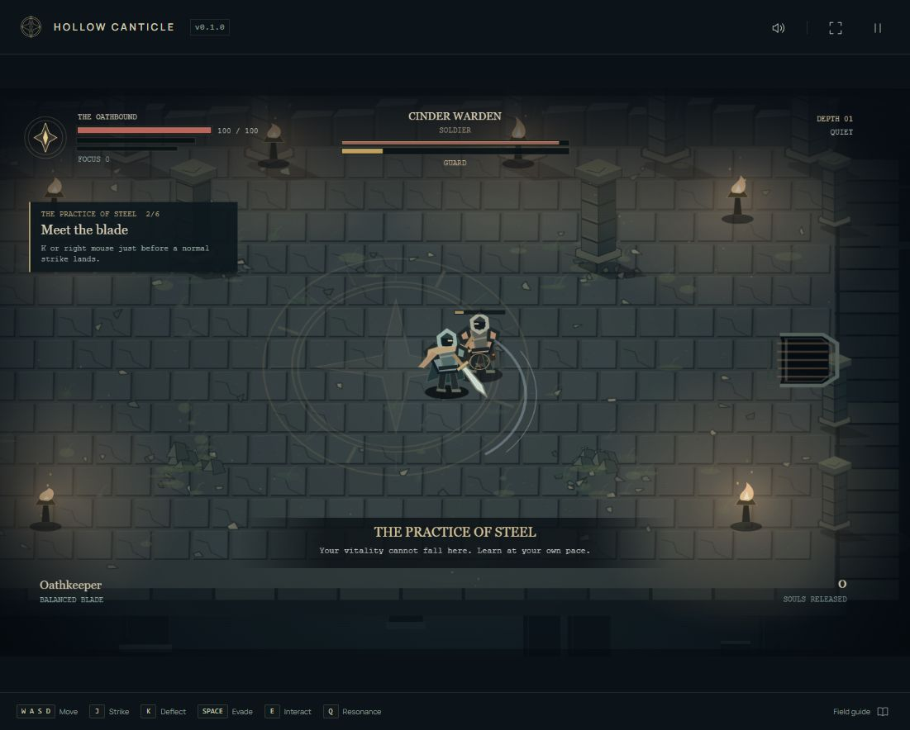
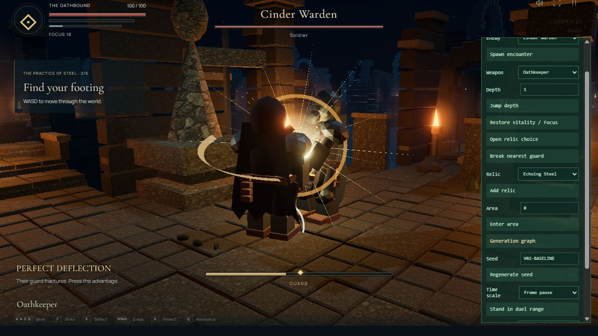
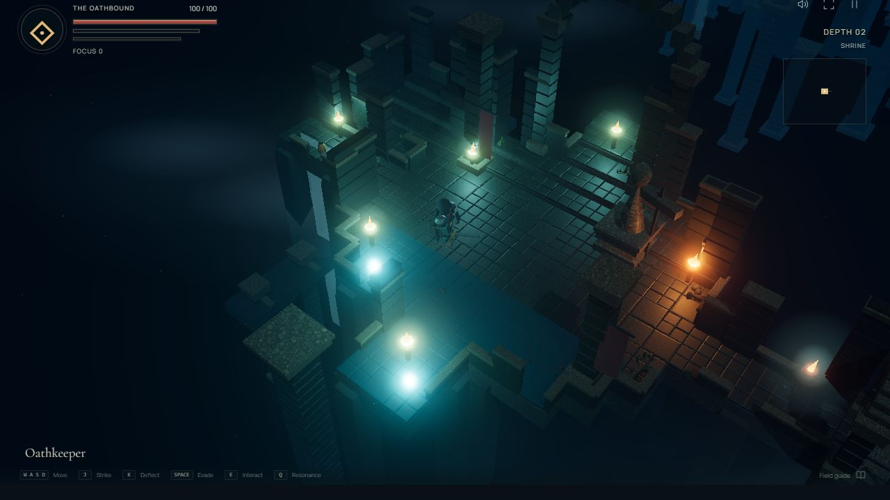
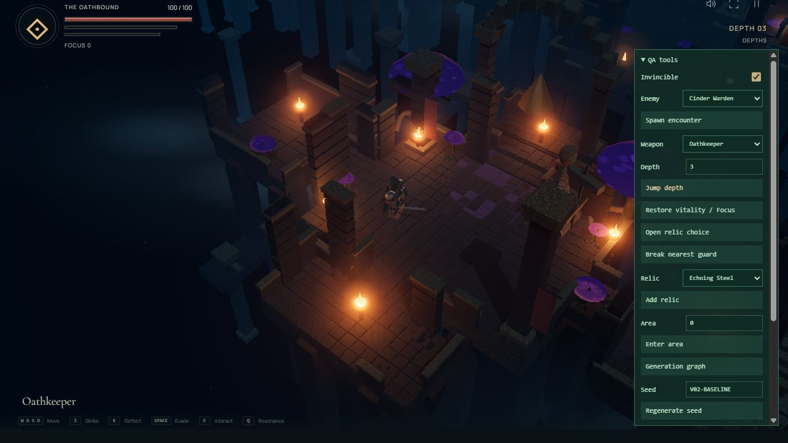
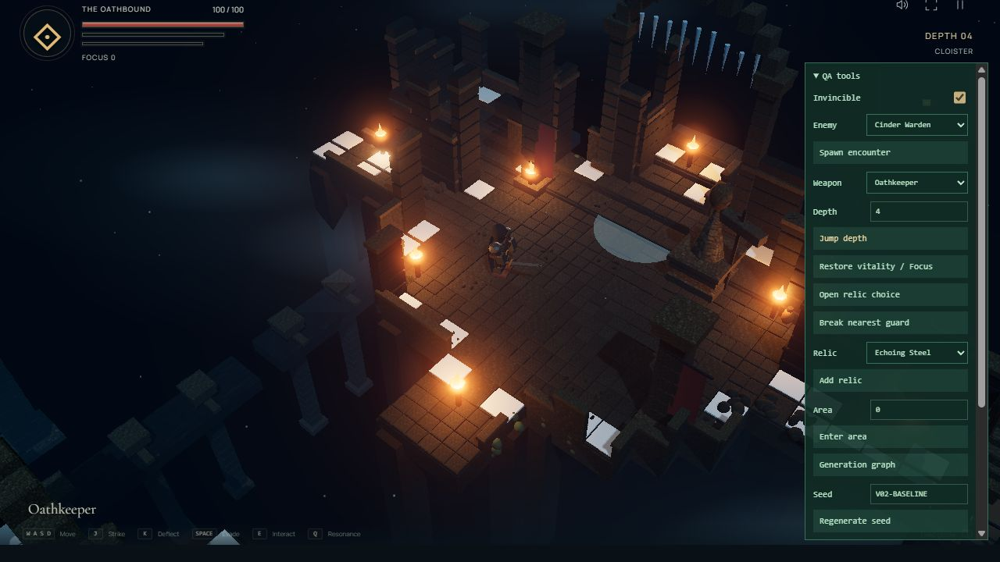
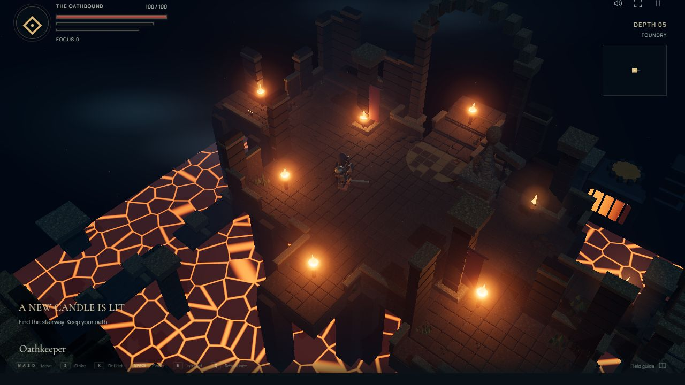
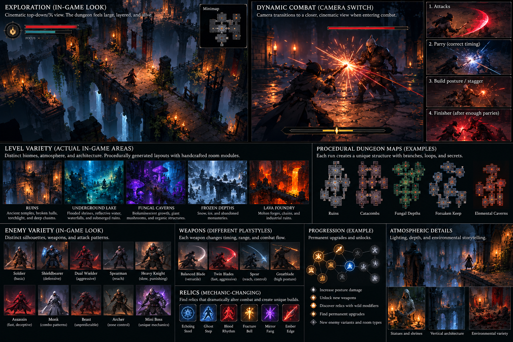

# v0.2 visual comparison

These are actual browser captures. The reference remains a separate, labeled design
target. No reference or prerendered scene is used behind the playable game.

| v0.1 actual exploration                           | v0.2 actual exploration                         |
| ------------------------------------------------- | ----------------------------------------------- |
|  |  |

The camera no longer fits an isolated board. It follows the player through projected
architecture and raised modules. The scene contains neighboring bridges and areas,
foundations, distant/lower structures, localized light, and foreground architecture.

| v0.1 actual duel                       | v0.2 actual cinematic duel                        |
| -------------------------------------- | ------------------------------------------------- |
|  |  |

The close camera is positioned beside the player, with larger articulated fighters,
visible weapons, contact effects, and the same dungeon backdrop. Combat detail is
additional geometry; it is not an enlarged exploration bitmap or a separate fight state.

## Biome checks

| Drowned Shrine                                | Fungal Choir                                |
| --------------------------------------------- | ------------------------------------------- |
|  |  |

| Winter Cloister                             | Ember Foundry                                 |
| ------------------------------------------- | --------------------------------------------- |
|  |  |

## Supplied quality target

## Iteration record

1. Baseline: isolated rectangular floor, fixed room framing, flat vector characters.
2. First spatial pass: WebGL platforms, bridges, lower supports, actual perspective,
   and a player-following camera. Review identified clean regular slabs and broad light.
3. Environment pass: broken wall masses, lower walkways, colder unlit stone,
   clustered foliage/debris, stronger landmarks, and smaller warm pools.
4. First duel pass: low camera and readable large fighters. Review identified glossy
   armor, overlapping composition, and broad opaque trails.
5. Combat pass: matte textured armor/cloth, wider lateral framing, finer weapon trails,
   impact rays, localized contact light, recoil, two-blade silhouettes, and finisher hold.
6. Performance pass: room-level instancing/culling, lightweight bevels, per-joint actor
   merging, bounded lights, and a quality fallback. Navigation and hazard presentation
   were checked against the new physical surfaces.
7. Final biome review: replaced the uniform orange lava plane with animated cracked
   crust, and added curved mushroom caps with mottled markings.

The duel impact capture uses a real training perfect parry, slowed and frame-paused
with the visible QA tools. Biome captures use QA depth selection. No artwork was
composited into these captures. See [QA details and measurements](QA.md).

## Remaining visual gap

The game's character art is visibly stylized and low-poly. It does not reproduce the
concept's painted anatomy, cloth, sculpture, or cinematic asset fidelity. Water uses
surface/light approximations rather than real reflections. Repeated modular stonework
is still visible, and more artist-authored meshes and animation would improve it.
The spatial composition and combat camera are fundamental changes; that does not
make the remaining art-fidelity gap disappear.
